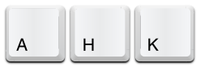
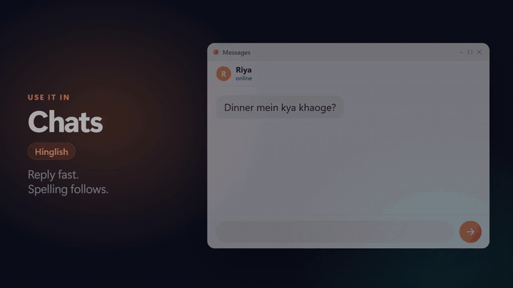
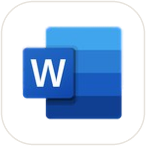
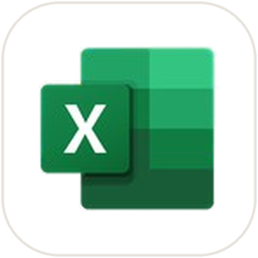
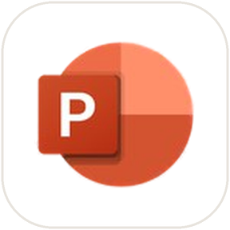
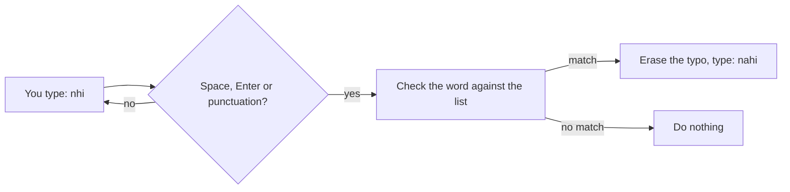

<div align="center">


# AutoCorrect Global

**Typos fix themselves.** System-wide autocorrect for Windows in **English**, **हिंदी** (Devanagari) and **Hinglish** (Hindi in English letters).

<a href="https://www.autohotkey.com/"></a><br>
<sub>Built on <a href="https://www.autohotkey.com/"><b>AutoHotkey</b></a>, free and open-source software.</sub>

[](LICENSE)
[](https://www.autohotkey.com/)
[](#get-started)
[](https://github.com/Manish-404/autocorrect-global/stargazers)

### ⭐ If it saves you from one embarrassing typo, [star the repo](https://github.com/Manish-404/autocorrect-global)
It's free, and a star helps other English, Hindi and Hinglish typists find it.

[**Website**](https://manish-404.github.io/autocorrect-global/) · [**Download ZIP**](https://github.com/Manish-404/autocorrect-global/archive/refs/heads/main.zip) · [**Watch the 27-second video**](https://manish-404.github.io/autocorrect-global/#video)

[](https://manish-404.github.io/autocorrect-global/#video)

</div>

## What it does

A tiny background script watches what you type. When you finish a word with Space, Enter or punctuation, it checks the word against its list and, if it is a known typo, replaces it with the right spelling. No special box, no account, no internet.

| You type | You get | Language |
| --- | --- | --- |
| `Send teh report tommorow` | Send the report tomorrow | English |
| `Mjhe bht bhook lgi hai, kuhc khane ko do jldi.` | Mujhe bahut bhook lagi hai, kuch khane ko do jaldi. | Hinglish |
| `आज मेंने उसे नही देखा` | आज मैंने उसे नहीं देखा | हिंदी |

Your capitals are kept (`Nhi` → `Nahi`, `NHI` → `NAHI`).

## Where you can use it

<table>
  <tr align="center">
    <td><br><b>Word</b></td>
    <td><br><b>Excel</b></td>
    <td><br><b>PowerPoint</b></td>
    <td><br><b>Outlook</b></td>
    <td><br><b>WhatsApp</b></td>
  </tr>
</table>

**Works in all of them, and anywhere else you can type.** Word, Excel and PowerPoint are tested with real files (table below). Outlook and WhatsApp use ordinary text boxes and are not in the automated test yet, because testing them needs a signed-in account.

Anywhere you type in Windows: chats, email, documents, spreadsheets, slides, comments, captions, search and address bars. These are the everyday places we tried, with the exact line typed in each:

| Where | Language | Typed | Fixed |
| --- | --- | --- | --- |
| Chats and messages | Hinglish | `Mjhe bht bhook lgi hai` | Mujhe bahut bhook lagi hai |
| Email | English | `Send teh report tommorow` | Send the report tomorrow |
| Word | हिंदी | `आज मेंने उसे नही देखा` | आज मैंने उसे नहीं देखा |
| Excel cell | Hinglish | `ghr ka kiraya` | ghar ka kiraya |
| PowerPoint slide title | Hinglish | `Hmari kahani, hmara safar` | Hamari kahani, hamara safar |
| Comments and captions | Hinglish | `Bdhiya video, awaaz thdi dhimi` | Badhiya video, awaaz thodi dhimi |
| Search and address bars | Hinglish | `shyd kal barish hogi` | shayad kal barish hogi |

### What we actually tested

Not a guess: [`tools/compat`](tools/compat) opens each program, types a real sentence the way a person would, copies what ended up in the box and compares it with what should be there.

| Program | English | Hinglish | हिंदी |
| --- | :---: | :---: | :---: |
| WordPad | ✅ | ✅ | ✅ |
| Microsoft Word | n/a¹ | ✅ | ✅ |
| Microsoft Excel | n/a¹ | ✅ | ✅ |
| Microsoft PowerPoint | n/a¹ | ✅ | ✅ |
| Chrome: text box on a page | ✅ | ✅ | ✅ |
| Chrome: address bar | ✅ | ✅ | ✅ |
| Firefox: text box on a page | ✅ | ✅ | ✅ |
| Firefox: address bar | ✅ | ✅ | ✅ |

Tested on Windows 11 23H2 with AutoHotkey 1.1.37.02, Chrome 155, Firefox 158 and Microsoft 365 Apps 16.0. Runs that were interrupted by other windows taking focus were repeated. The Hindi sentences were sent to the programs as Unicode keystrokes by the test script (the test PC has no Hindi keyboard installed), not typed on a physical Hindi keyboard.
¹ Word, Excel and PowerPoint ship their own AutoCorrect list that overlaps the English fixes, so an English pass there would not prove which tool did the work.

**Not tested yet:** Outlook and WhatsApp (testing them needs a signed-in account), Notepad, other desktop chat apps, code editors, games. They are ordinary Windows text boxes, so they should work, but we have not checked each one. Run `tools\compat\run_compat.ps1` to test yours.

## Get started

1. **Install AutoHotkey v1.1** (free) from [autohotkey.com](https://www.autohotkey.com/) and choose **v1.1**. The scripts are written for v1.1, not v2.
2. **[Download the ZIP](https://github.com/Manish-404/autocorrect-global/archive/refs/heads/main.zip)** and unzip it anywhere.
3. **Double-click** the script or scripts you want. A green **H** appears in the tray. Each script only touches its own language, and they never fix the same word twice.
4. *(Optional)* **Start with Windows:** press `Win + R`, type `shell:startup`, and put a shortcut to each script in that folder.
5. *(For Hindi)* add a Hindi keyboard: Settings → Time & language → add **Hindi** → add the **Hindi Traditional** keyboard. Keep `AutoCorrectHindi.ahk` saved as **UTF-8 with BOM**, or AutoHotkey v1 can't read the Devanagari.

## The three scripts

| File | Language | Fixes | Add your own |
| --- | --- | --- | --- |
| [`AutoCorrect.ahk`](AutoCorrect.ahk) | English | about 4,700 | `Win + H` |
| [`AutoCorrectHindi.ahk`](AutoCorrectHindi.ahk) | Hindi, Devanagari | about 320 | `Win + Shift + H` |
| [`AutoCorrectHinglish.ahk`](AutoCorrectHinglish.ahk) | Hinglish | 34,377 on, 3,762 optional | `Win + Alt + H` |

Select a word, press the hotkey, type the right spelling: the line is added to the bottom of that script and the script reloads. To remove a fix you don't like, delete its line.

Each file keeps a block of **optional** fixes, commented out, for spellings where common usage and the official standard differ (`महत्व`/`महत्त्व`, `kyu`/`kyun`). Switch on the ones you agree with.

## How it works

Each script is a plain text file for [AutoHotkey](https://www.autohotkey.com/), a free, open-source tool that can watch the keyboard. One rule is one line, called a *hotstring*:

```ahk
::nhi::nahi
```



* **Safe by design.** Only words that are clearly misspelled are fixed. Spellings people really use (`kyu` and `kyun`, `acha` and `accha`) are left alone, and ambiguous ones are commented out.
* **Private.** The scripts contain no network code and store nothing. They are short, readable text files.
* **Hindi end marks.** The danda `।` and `॥` also end a word.

### How the Hinglish list was built

Hinglish has no official spelling, so [`AutoCorrectHinglish.ahk`](AutoCorrectHinglish.ahk) is **generated** from word lists (about 11,700 known words) by [`tools/hinglish`](tools/hinglish): chat shorthand with the vowels dropped (`nhi`, `mjhe`, `krna`), swapped letters (`kuhc`) and dropped letters (`samjega`). Every candidate then has to pass these filters, or it is thrown away:

* it is itself a real word in the list (so `kam`/`kaam`, `par`/`paar` are never mixed up);
* it is an English word (checked with the Windows spell checker);
* it could mean two different words;
* it is one letter away from a different known word;
* it would also fire in `AutoCorrect.ahk` (two scripts must never both rewrite a word);
* it swaps the letters of a 4-letter word that is not one of the very common ones (`abbu` must never become `babu`).

Checks on the result: a live typing test of 315 words (**315/315**), no duplicate or clashing entries, and a test on words the generator never saw, where 3 of about 200 rare words would be changed (all alternate spellings). Any fix you don't want is one line to delete.

#### Rebuild it

You need Python 3 and Windows (the spell check uses PowerShell and the Windows spell checker).

```powershell
cd tools\hinglish
python build.py          # reads lex\*.txt, filters, writes final.json  (about 25 s)
python emit.py           # writes ..\..\AutoCorrectHinglish.ahk
python verify_ahk.py     # BOM, duplicates, clashes with the other two scripts
```

To add words, edit the files in [`tools/hinglish/lex`](tools/hinglish/lex) (the format is described at the top of `build.py`) and rebuild.

## Test it in your own programs

```powershell
cd tools\compat
.\run_compat.ps1                                  # WordPad, Chrome and Firefox
.\run_compat.ps1 -Targets word,excel,powerpoint   # Microsoft Office
.\run_compat.ps1 -Language hindi                  # the Devanagari script
```

It only touches windows it opens itself: browsers get a throw-away profile, Office gets a blank file that is never saved, and your clipboard is put back. Keep your hands off the keyboard for a minute while it runs.

## Limits

* A program running **as administrator** ignores a normal script. Run the script as administrator too (right-click → *Run as administrator*).
* Games with anti-cheat, remote desktop windows and some secure input fields can block scripts that type for you.
* **Hindi** needs a keyboard that types Devanagari letter by letter, such as Windows' Hindi Traditional (INSCRIPT). Phonetic tools that compose whole words first were not tested.
* Some Hindi fixes (like `शक्ती` → `शक्ति`) are correct in Marathi. Delete those lines if you also type Marathi.
* Windows only, AutoHotkey v1.1 only. Some security tools are cautious about any script that watches the keyboard; the scripts are readable text if you want to check.

## Repository layout

```
AutoCorrect.ahk            English
AutoCorrectHindi.ahk       Hindi (Devanagari)
AutoCorrectHinglish.ahk    Hinglish (generated)
docs/                      the website (GitHub Pages)
tools/hinglish/            generator, word lists, tests
tools/compat/              tests that type into real programs
tools/spell.ps1            asks the Windows spell checker which words are English
tools/check_hindi.ps1      checks the Hindi file
```

## Contributing

Found a wrong fix, or a word that should be there? [Open an issue](https://github.com/Manish-404/autocorrect-global/issues) or a pull request. For Hinglish, add the word to the right file in `tools/hinglish/lex` and rebuild; please include a sentence that uses it.

## Credits and licence

* The Hindi and Hinglish scripts, the generator, the tests and the website are [MIT licensed](LICENSE).
* [`AutoCorrect.ahk`](AutoCorrect.ahk) is the long-standing AutoHotkey AutoCorrect script (Jim Biancolo, 2006), built on Wikipedia's [lists of common misspellings](https://en.wikipedia.org/wiki/Wikipedia:Lists_of_common_misspellings) (CC BY-SA 3.0) and the other sources named in its header. It is included as it was and keeps its own terms (see [NOTICE.md](NOTICE.md)).
* **Built on [AutoHotkey](https://www.autohotkey.com/)**, free and open-source software (GNU GPL v2) created by Chris Mallett and others. The AutoHotkey logo and icon shown here belong to the AutoHotkey project and are used as published, to say what this is built on (details in [NOTICE.md](NOTICE.md)). This project is independent and not affiliated with or endorsed by AutoHotkey.
* Microsoft, Excel, Outlook, PowerPoint and Word are trademarks of the Microsoft group of companies. WhatsApp, Chrome and Firefox are trademarks of their owners. Their logos in the "Where you can use it" row belong to their owners and are shown only to say where this works; they are not covered by the MIT licence, and this project is not affiliated with or endorsed by them.
* The promo video was made with [brag](https://github.com/latent-spaces/brag).

---

<div align="center">

### ⭐ Enjoyed it? [Star AutoCorrect Global on GitHub](https://github.com/Manish-404/autocorrect-global)

</div>
